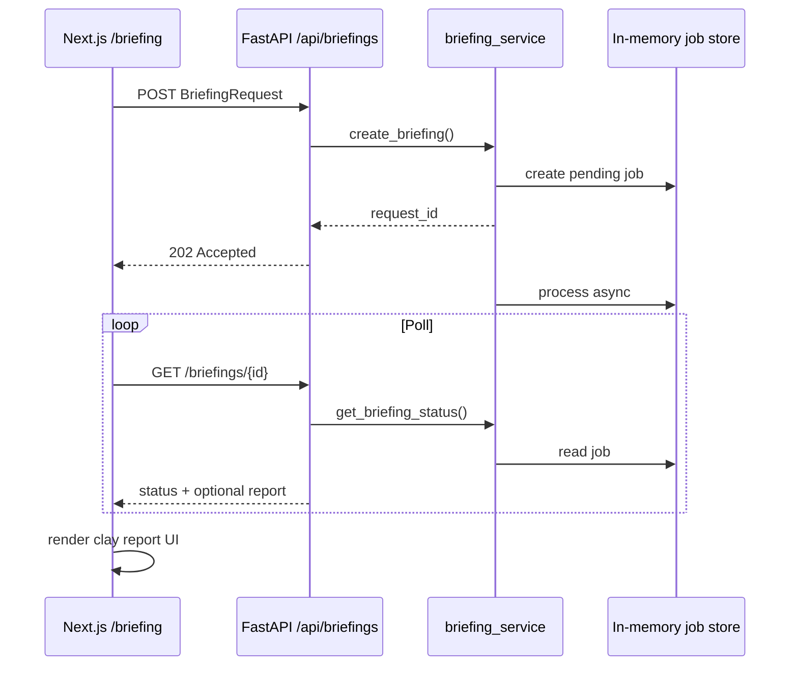

# Architecture — BriefCortex

## High-level flow

## Modules

### Frontend (`frontend/`)

| Area | Responsibility |
|------|----------------|
| `app/` | Next.js App Router pages; `/` redirects to `/briefing` |
| `src/components/briefing/` | Feature UI: form, empty/loading/error/report states |
| `src/hooks/briefing/` | Submit + poll orchestration |
| `src/api/` | Axios clients talking to FastAPI |
| `src/types/` | Shared TypeScript contracts |
| `src/lib/` | Env config and pure helpers |

### Backend (`backend/`)

| Area | Responsibility |
|------|----------------|
| `app/api/endpoints/` | Thin HTTP handlers |
| `app/services/briefing_service.py` | Async job accept + status |
| `app/services/ingestion.py` | Tavily retrieval + FactBase assembly |
| `app/services/analysis.py` | LLM BriefingReport generation |
| `app/services/conflict_detection.py` | Deterministic fact conflict engine |
| `app/models/` | HTTP Pydantic schemas |
| `app/core/config.py` | Settings via env |

## Design decisions

1. **Async accept + poll** — briefing generation can take seconds; `202` + status polling keeps the UI responsive without websockets.
2. **App router separate from `src/`** — matches the Shabble layout so routes stay thin and logic lives in hooks/services.
3. **In-memory job store** — enough for local demo; no database required yet.
4. **Conflict detection stays off the LLM path** — conflicts are returned to callers independently and never serialized into the prompt.

## Anti-patterns

- Do not call FastAPI directly from React components — go through `src/api/`.
- Do not put business logic in FastAPI route handlers — keep it in services.
- Do not feed conflict-detection output into the LLM prompt.
- Do not promote unverified analyst opinions into `executive_summary.recommendation`.
