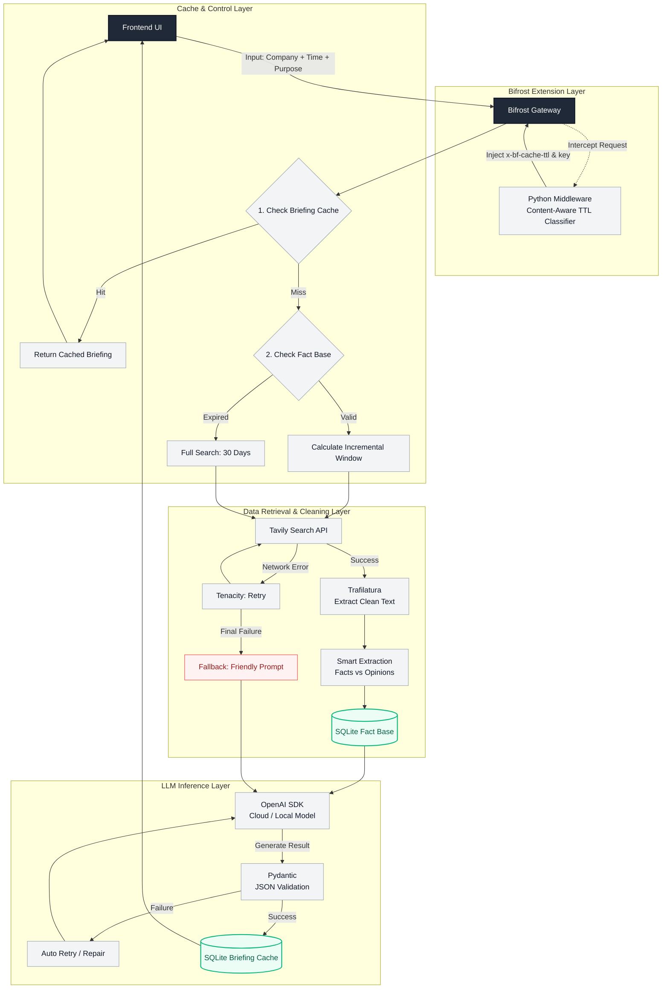

# BriefCortex

**Time-sliced competitive intelligence for high-stakes commercial meetings.**

BriefCortex turns a company name and a meeting objective into a cold, evidence-backed negotiation brief in seconds — not a generic news digest.

---

## The Problem

Traditional briefing tools fail deal teams in two specific ways:

1. **They have no sense of time.** A layoff reported 14 months ago is treated the same as one reported last week. Negotiation leverage decays; most tools don't model that decay. BriefCortex slices evidence by recency and weights it accordingly.
2. **They cannot separate fact from opinion.** Analyst chatter, rumored executive departures, and confirmed filings get flattened into one undifferentiated blob. A deal lead cannot tell what is safe to say in the room and what is a rumor that will blow up in their face.

Most tools therefore optimize for volume and fluency, not for whether a specific claim is safe to act on in a specific meeting. That is the gap BriefCortex targets.

---

## What BriefCortex Does

Given `{company, meeting_purpose}`, BriefCortex produces a structured `BriefingReport`:

- **Plan-then-search retrieval**: the model decides which queries to run and which publisher categories to hit, constrained to a source registry.
- **Per-publisher scoping**: 13 domains each get their own path and body-boundary rules, so navigation trees, related-article blocks and paywalls never become facts.
- **30-day freshness**: both the publication date and the reporting period inside each sentence are checked.
- **Hard facts only**: commentator framing never reaches the LLM.
- **Executive summary with numeric negotiation asks**, derived only from hard facts — or a directional business read when no objective was supplied.
- **A deterministic conflict-detection lane** that flags contradictory facts with both sources attached — and is *never* fed into the LLM.
- **Dual-layer caching** so the second identical request returns in milliseconds.

---

## Architecture Highlights

<!-- ARCH_DIAGRAM -->

End-to-end data flow, from the UI through the Bifrost gateway, the retrieval and cleaning layer, to structured LLM output.



*(The same diagram lives in `docs/ARCHITECTURE.md` alongside the module responsibilities and design decisions.)*

### 1. Bifrost Time-Slicing

Evidence is not a flat list. Bifrost partitions retrieved material into time slices (e.g. last 7 days / last 90 days / older), so the prompt can distinguish "fresh leverage" from "stale context". A 2023 layoff does not get used as a 2026 negotiation lever.

### 2. Retrieval: Plan, Scope, Then Read

Retrieval is not a single query against a flat domain list.

**Planning.** `search_planner.py` asks the model for a search plan — which queries to run and which publisher categories to use. The model may only choose *categories* from a fixed source registry (`financial_wire`, `financial_business`, `asia_market`, `auto_industry`, `official_primary`); any category outside it is discarded, and domains are resolved from the registry, so a fabricated host can never reach the search API. When the model is unavailable the planner falls back to a deliberately industry-agnostic financial plan, so a bank and an automaker both get valid coverage.

**Scoping.** Two rule tables are keyed by publisher and verified against live pages:

- `SITE_SECTION_RULES` — keep/drop path prefixes, so opinion columns, live blogs, stock-quote tables and video pages are never read. Longest-domain matching keeps `markets.businessinsider.com` on its own rules.
- `SITE_BODY_RULES` — per-publisher body open and close markers plus chrome-line filters. Bloomberg opens with a ~190-line corporate mega-menu, CNBC arrives as a single newline-free blob, FT returns a paywall, gasgoo trails a "Related Articles" block that names other companies. Each needs its own boundary; one shared rule set cannot cover them.

**Reading.** Hard facts are the opening three paragraphs plus the closing paragraph. Middle paragraphs contribute only their first sentence, and only when it carries a negative signal — so the fact base gets the leverage without absorbing the commentator's framing.

**Depth.** A coverage loop keeps searching while a round still contributes previously unseen URLs that carry an article body (`MAX_SEARCH_ROUNDS=20`). Tavily returns 10 results by default and accepts 20; above 20 the response is unreliable (measured: 25 → 16, 30 → 1), so extra coverage comes from more queries rather than a larger page size. When a publisher returns results without bodies, that publisher is dropped and the same queries re-run, so a syndicated telling can take the slot an empty page was holding.

### 3. Freshness: Publication Date and Reporting Period

Two different clocks matter, and only checking one is not enough.

- **Publication date.** Tavily timestamps are RFC 2822 (`Wed, 21 Oct 2026 00:00:00 GMT`), which `datetime.fromisoformat` rejects outright, so the date is parsed with `email.utils.parsedate_to_datetime`. When a result still arrives without a date, a two-tier fallback runs: the date is read out of the URL slug first (offline, and it survives the anti-bot walls that answer Reuters with 401 and Bloomberg with 403), then from a page fetch via `htmldate`.
- **Reporting period.** An article published inside the window can still report an older period ("in the first five months of 2026", "third quarter of 2025"). Those sentences are dropped. Comparisons are kept, because "lowest since April 2025" describes where things stand *now*.

Duplicate sentences are kept once, and the longer telling wins — a bare figure from one outlet does not shadow the same figure with its breakdown from another.

### 4. Two Report Modes

The report follows the meeting objective when one is supplied: numeric asks, leverage, trades.

With no objective, the brief is a *fundamentals* brief — the company's business direction, what is demonstrably working, and what deserves caution. In that mode the model is forbidden from inventing a target or emitting numeric demands, and the anti-hallucination fallback sentence is scoped to negotiation mode only.

### 5. Fact / Opinion Separation

`FactBase` carries two distinct lists: `hard_facts` and `analyst_opinions`. They are rendered into the LLM prompt as separate, labeled blocks (`<HARD_FACTS>`, `<ANALYST_OPINIONS>`). The system prompt forbids using unverified commentary as negotiation leverage. If hard facts contain no negative signal, the model is required to output the exact fallback sentence:

> "Evidence insufficient; recommend standard outreach."

No fabrication, no manufactured aggression.

### 6. Conflict Detection as an Independent, Auditable Lane

`detect_fact_conflicts()` runs a deterministic regex rule engine over `hard_facts` only. It returns structured conflicts with both sides' `source_url`, and its output is **never fed into the LLM prompt**.

LLM output and conflict detection are two independent tracks by design: semantics cannot override evidence, and evidence cannot be reinterpreted by semantics.

### 7. Dual-Layer Cache

- **Layer 1 — exact-request cache:** identical `{company, meeting_purpose}` returns the stored report instantly.
- **Layer 2 — evidence cache:** Tavily retrieval results are cached per company with a TTL, so a re-run with a different `meeting_purpose` skips retrieval entirely.

Demo implication: the second run is a millisecond response, not a 30-second LLM call.

### 8. Tested, Not Vibes

The repo ships with `pytest` coverage for both the prompt/schema contract and the conflict engine, including:

- Prompt output schema must match the real Pydantic `BriefingReport` schema.
- No ghost fields (`verified`, `negotiation_levers`, `target_concessions`) may appear.
- `\brif\b` must not match `tariff`.
- Single-fact internal contradictions must not be reported as cross-item conflicts.
- Reverse-direction pairs must produce a description with the correct fact on each side.

---

## Repository Layout

```
BriefCortex/
├── frontend/                 # Next.js App Router UI
│   ├── app/                  # Routes (`/` redirects to `/briefing`)
│   └── src/                  # Components, hooks, API clients, types
├── backend/                  # FastAPI service
│   ├── app/
│   │   ├── api/              # Route handlers
│   │   ├── core/             # Settings + DB engine
│   │   ├── db/               # SQLAlchemy ORM models
│   │   ├── repositories/     # Data access (Postgres)
│   │   ├── models/           # Pydantic request/response schemas
│   │   ├── services/         # Ingestion, search planning, analysis, conflict detection, briefing orchestration
│   │   └── mock/             # Demo briefing payload
│   └── tests/
└── docs/                     # ARCHITECTURE, CLAUDE, KARPATHY
```

---

## Local Setup

### Backend

```bash
# optional: local Postgres
docker compose up -d db

cd backend
python -m venv .venv
# Windows: .venv\Scripts\activate
# macOS/Linux: source .venv/bin/activate
pip install -r requirements.txt
cp .env.example .env
uvicorn app.main:app --reload --port 8000
```

### Frontend

```bash
cd frontend
cp .env.example .env.local
npm install
npm run dev
```

Open [http://localhost:3000](http://localhost:3000) — the app redirects to `/briefing`.

### API contract

- `POST /api/briefings` — accepts `{ company_name, meeting_time, meeting_purpose }`, returns `202` with `{ id }`
- `GET /api/briefings` — list saved briefings (newest first)
- `GET /api/briefings/{id}` — fetch/poll a briefing by id until `status` is `completed` or `failed`

---

## Running Tests

```bash
cd backend
python -m pytest tests/ -v
```

Expected: 20 passed.

> Note: on Python 3.15 the Tsinghua mirror does not ship a `pytest` wheel. Install from the official index: `pip install pytest --index-url https://pypi.org/simple`.

---

## Design Constraints

Two constraints are enforced in code, not just in prose:

- **Hard facts are the only source of negotiation leverage.** Unverified commentary is rendered in a separate prompt block and cannot be promoted into the numeric asks of `executive_summary.recommendation`.
- **Conflict detection is not part of the LLM path.** `detect_fact_conflicts()` returns structured conflicts to callers; it is never serialized into the model input. The two outputs are consumed independently.

---

## Contributing

1. Branch from `main` with a `feature/`, `fix/`, or `chore/` prefix.
2. Follow conventions in `docs/CLAUDE.md` and the coding behavior contract in `docs/KARPATHY.md`.
3. Keep route handlers thin; put business logic in services.
4. Open a PR with a clear summary and test notes.
