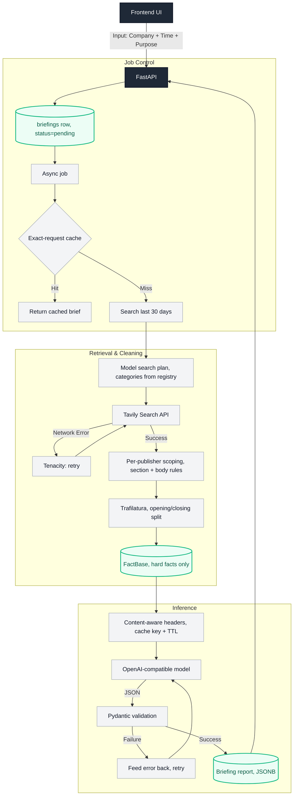

# BriefCortex

**Time-sliced competitive intelligence for high-stakes commercial meetings.**

BriefCortex turns a company name and a meeting objective into a cold, evidence-backed negotiation brief in seconds — not a generic news digest.

---

## The Problem

Traditional briefing tools fail deal teams in two specific ways:

1. **They have no sense of time.** A layoff reported 14 months ago is treated the same as one reported last week. Negotiation leverage decays; most tools don't model that decay. BriefCortex slices evidence by recency and weights it accordingly.
2. **They cannot separate fact from opinion.** Analyst chatter, rumored executive departures, and confirmed filings get flattened into one undifferentiated blob. A deal lead cannot tell what is safe to say in the room and what is a rumor that will blow up in their face.

Most tools therefore optimize for volume and fluency, not for whether a specific claim is safe to act on in a specific meeting. That is the gap BriefCortex targets.

---

## What BriefCortex Does

Given `{company, meeting_purpose}`, BriefCortex produces a structured `BriefingReport`:

- **Plan-then-search retrieval**: the model decides which queries to run and which publisher categories to hit, constrained to a source registry.
- **Company identity before retrieval**: the legal-entity registry supplies jurisdiction and legal form, which decides which regulator the legal searches name.
- **Per-publisher scoping**: 13 domains each get their own path and body-boundary rules, so navigation trees, related-article blocks and paywalls never become facts.
- **30-day freshness**: both the publication date and the reporting period inside each sentence are checked.
- **Hard facts first**: facts are what the model may turn into leverage; unverified commentary and job postings sit in their own blocks with their own rules.
- **Executive summary with numeric negotiation asks**, derived only from hard facts — or a directional business read when no objective was supplied.
- **A deterministic conflict-detection lane** that flags contradictory facts with both sources attached — and is *never* fed into the LLM.
- **An exact-request cache** so the same request inside its window returns the stored brief without re-running retrieval or inference.

---

## Architecture Highlights

<!-- ARCH_DIAGRAM -->

End-to-end data flow: the UI, the async job that owns the request, the retrieval and cleaning layer, and the structured LLM output.



*(The diagram is the canonical one; the module map and design decisions below carry the detail.)*

### 1. Freshness: A 30-Day Window, Checked Twice

Two clocks matter, and checking only one is not enough. Both are enforced over a 30-day search window.

- **Publication date.** Tavily timestamps are RFC 2822 (`Wed, 21 Oct 2026 00:00:00 GMT`), which `datetime.fromisoformat` rejects outright, so the date is parsed with `email.utils.parsedate_to_datetime`. When a result still arrives without a date, a two-tier fallback runs: the date is read out of the URL slug first (offline, and it survives the anti-bot walls that answer Reuters with 401 and Bloomberg with 403), then from a page fetch via `htmldate`.
- **Reporting period.** An article published inside the window can still report an older period ("in the first five months of 2026", "third quarter of 2025"). Those sentences are dropped. Comparisons are kept, because "lowest since April 2025" describes where things stand *now*.

A 2023 layoff cannot be used as a 2026 negotiation lever.

### 2. Retrieval: Plan, Scope, Then Read

Retrieval is not a single query against a flat domain list.

**Planning.** `search_planner.py` asks the model for a search plan — which queries to run and which publisher categories to use. The model may only choose *categories* from a fixed source registry (`financial_wire`, `financial_business`, `asia_market`, `auto_industry`, `official_primary`); any category outside it is discarded, and domains are resolved from the registry, so a fabricated host can never reach the search API. When the model is unavailable the planner falls back to a deliberately industry-agnostic financial plan, so a bank and an automaker both get valid coverage.

**Scoping.** Two rule tables are keyed by publisher and verified against live pages:

- `SITE_SECTION_RULES` — keep/drop path prefixes, so opinion columns, live blogs, stock-quote tables and video pages are never read. Longest-domain matching keeps `markets.businessinsider.com` on its own rules, and year-indexed paths follow the calendar instead of a hard-coded year.
- `SITE_BODY_RULES` — per-publisher body open and close markers plus chrome-line filters. Bloomberg opens with a ~190-line corporate mega-menu, CNBC arrives as a single newline-free blob, FT returns a paywall, gasgoo trails a "Related Articles" block that names other companies. Each needs its own boundary; one shared rule set cannot cover them.

**Reading.** Hard facts are the opening three paragraphs plus the closing paragraph. Middle paragraphs contribute only their first sentence, and only when it carries a negative signal — so the fact base gets the leverage without absorbing the commentator's framing. Signals are matched on word boundaries plus inflections, so `miss` cannot fire inside `mission`.

**Depth.** Coverage stops on two budgets. A round must contribute previously unseen URLs that carry an article body, otherwise the loop exits (`MIN_USABLE_PER_ROUND`); the loop also stops at `SEARCH_BUDGET_SECONDS` so a request returns inside the client's poll window, with `MAX_SEARCH_ROUNDS=8` guarding a runaway plan. Tavily returns 10 results by default and accepts 20; above 20 the response is unreliable (measured: 25 → 16, 30 → 1), so extra coverage comes from more queries rather than a larger page size. If a publisher returns results without bodies, it is dropped and the same queries re-run once, so a syndicated telling can take the slot an empty page was holding.

**Deduplication.** An identical sentence is stored once. A syndicated re-run that extends the stored sentence word for word replaces it, but only when the shared opening is long enough to be the same telling — two different facts that happen to open with the same clause both stay.

### 3. Two Report Modes

The report follows the meeting objective when one is supplied: numeric asks, leverage, trades.

With no objective, the brief is a *fundamentals* brief — the company's business direction, what is demonstrably working, and what deserves caution. In that mode the model is forbidden from inventing a target or emitting numeric demands, and the anti-hallucination fallback sentence is scoped to negotiation mode only.

### 4. Fact / Opinion Separation
`FactBase` carries two distinct lists: `hard_facts` and `analyst_opinions`. They are rendered into the LLM prompt as separate, labeled blocks (`<HARD_FACTS>`, `<ANALYST_OPINIONS>`). The system prompt forbids using unverified commentary as negotiation leverage. If hard facts contain no negative signal, the model is required to output the exact fallback sentence:

> "Evidence insufficient; recommend standard outreach."

No fabrication, no manufactured aggression.

### 5. Conflict Detection as an Independent, Auditable Lane
`detect_fact_conflicts()` runs a deterministic regex rule engine over `hard_facts` only. It returns structured conflicts with both sides' `source_url`, and its output is **never fed into the LLM prompt**.

LLM output and conflict detection are two independent tracks by design: semantics cannot override evidence, and evidence cannot be reinterpreted by semantics.

### 6. Cache: Two Different Jobs

There are two caches, and they answer different questions.

**Exact-request cache** (`services/cache.py`). A finished brief is keyed on
company + objective + meeting date. An identical request inside the TTL returns
the stored brief instead of paying for retrieval and inference again. Meeting
time is keyed to the day, because the evidence window is anchored to the date —
two meetings on one day produce the same brief.

**Content-aware TTL headers** (`services/bifrost_headers.py`). When a request
does reach a model, the evidence decides how long the response may be cached.
Fact texts are matched against three word-boundary rule sets, so `third quarter`
is not read as a hiring signal and `shares` does not fire on `shareholders`.

| Class | Signals | TTL |
|---|---|---|
| `volatile` | earnings, guidance, stock moves, recalls, lawsuits | 24h |
| `structural` | hiring, appointments, product launches | 72h |
| `primary` | annual reports, filings, press releases | 168h |

Classes apply by precedence: a fact set is only as cacheable as its most
perishable member. The headers (`x-bf-cache-key`, `x-bf-cache-ttl`,
`x-bf-content-class`) ride on the outgoing request, so the gateway needs no
source changes.

### 7. Tested, Not Vibes

The repo ships with `pytest` coverage for the prompt/schema contract, the conflict engine, the extraction rules and the cache classifier, including:

- Prompt output schema must match the real Pydantic `BriefingReport` schema.
- No ghost fields (`verified`, `negotiation_levers`, `target_concessions`) may appear.
- `\brif\b` must not match `tariff`.
- Single-fact internal contradictions must not be reported as cross-item conflicts.
- Reverse-direction pairs must produce a description with the correct fact on each side.
- Negative-signal keywords match whole words, so `miss` cannot match `mission`.
- Two distinct facts sharing an opening clause are both kept; only a long word-for-word extension replaces the shorter telling.
- The cache TTL classifies evidence by whole word, so `third quarter` is not read as a hiring signal.

---

## Repository Layout

```
BriefCortex/
├── frontend/                 # Next.js App Router UI
│   ├── app/                  # Routes (`/` redirects to `/briefing`)
│   └── src/                  # Components, hooks, API clients, types
├── backend/                  # FastAPI service
│   ├── app/
│   │   ├── api/              # Route handlers
│   │   ├── core/             # Settings + DB engine
│   │   ├── db/               # SQLAlchemy ORM models
│   │   ├── repositories/     # Data access (Postgres)
│   │   ├── models/           # Pydantic schemas (briefing report + fact base)
│   │   ├── services/         # Retrieval, identity, lanes, analysis, job orchestration
│   │   └── mock/             # Demo briefing payload
│   ├── migrations/           # Alembic revisions
│   └── tests/
├── docs/                     # CLAUDE, KARPATHY
└── docker-compose.yml        # Postgres, Bifrost gateway, Redis Stack
```

---

## Module Map

### Backend services

| Area | Responsibility |
|------|----------------|
| `services/briefing_service.py` | Async job accept, cache lookup, status orchestration, stale-job recovery |
| `services/ingestion.py` | Retrieval orchestration; assembles facts, opinions, hiring and incidental lanes |
| `services/search_planner.py` | Model-driven search plan, constrained to a source registry |
| `services/company_identity.py` | Registry lookup for jurisdiction and legal form (GLEIF) |
| `services/legal_signals.py` | Jurisdiction-aware searches for legal and regulatory exposure |
| `services/source_rules.py` | Publisher registry and per-publisher extraction rules |
| `services/publisher_filter.py` | URL scoping, article-body location, text extraction |
| `services/fact_extraction.py` | Inverted-pyramid split, dedup, source ordering |
| `services/freshness.py` | Publication dates, date fallback, reporting-period checks |
| `services/article_subject.py` | Routes each article by who it is about |
| `services/sentence_classifier.py` | Fact vs opinion labeling for incidental sentences |
| `services/incidental*.py` | Facts about us found inside other companies' coverage |
| `services/corroboration.py` | Targeted follow-up search for an incidental fact |
| `services/hiring.py` | Careers-page detection and hiring queries |
| `services/dedup.py` | Two-stage fact merging that keeps every source |
| `services/retention.py`, `scheduler.py` | Evidence expiry and URL decay, run on a daily loop |
| `services/cache.py` | Exact-request cache key and TTL |
| `services/analysis.py` | LLM report generation and prompt assembly |
| `services/conflict_detection.py` | Deterministic fact conflict engine |
| `services/bifrost_headers.py` | Content-aware cache key and TTL derived from the evidence |
| `services/keywords.py`, `urls.py`, `window.py` | Shared matchers, URL parsing, meeting-anchored window |
| `repositories/` | Postgres data access only |
| `core/` | Settings, DB engine/session, connection checks |

### Frontend

| Area | Responsibility |
|------|----------------|
| `app/` | Next.js App Router pages; `/` redirects to `/briefing` |
| `src/components/briefing/` | Form, report states, evidence panel, side panel |
| `src/hooks/briefing/` | Submit, poll, list, select, clone (client-only) |
| `src/api/` | Axios clients talking to FastAPI |
| `src/types/`, `src/lib/` | Shared contracts and pure helpers |

---

## Design Decisions

1. **Async accept + poll** — generation takes seconds; `202` + polling keeps the UI responsive without websockets. Jobs are held in a task set so the event loop cannot collect them mid-run, and a job stuck in `processing` is failed on next startup.
2. **Subject routing, not name matching** — an article that merely names the company is not about the company. Each article is routed by its subject before any fact is trusted, which is what stopped a competitor's reporting being filed as ours.
3. **Hiring is its own lane** — a posting states intent, not outcome, so it informs the model without being asserted as a reported fact.
4. **One fact, every source** — the same fact from five outlets is stored once with all five links. Coverage count is not the claim's value.
5. **Conflict detection stays off the LLM path** — conflicts are computed independently and served beside the report, never inside the prompt.
6. **Postgres + repository** — each briefing is a row keyed by UUID; the report lives in one JSONB column.
7. **One configuration channel** — every key is read through `app/core/config.py`, and the `.env` path is resolved against the module.
8. **Schema changes go through Alembic** — `init_db()` only checks connectivity and warns when the revision is behind; it never alters tables.

## Anti-patterns

- Do not call FastAPI directly from React components — go through `src/api/`.
- Do not put business logic in route handlers — keep it in services.
- Do not put SQL in services — go through repositories.
- Do not feed conflict-detection output into the LLM prompt.
- Do not let unverified commentary become a numeric ask in `executive_summary.recommendation`.
- Do not gate an article on whether the company name appears; ask what the article is about.

---

### Backend

```bash
# optional: local Postgres
docker compose up -d db

cd backend
python -m venv .venv
# Windows: .venv\Scripts\activate
# macOS/Linux: source .venv/bin/activate
pip install -r requirements.txt
cp .env.example .env
uvicorn app.main:app --reload --port 8000
```

### Frontend

```bash
cd frontend
cp .env.example .env.local
npm install
npm run dev
```

Open [http://localhost:3000](http://localhost:3000) — the app redirects to `/briefing`.

### API contract

- `POST /api/briefings` — accepts `{ company_name, meeting_time, meeting_purpose }`, returns `202` with `{ id, status }`
- `GET /api/briefings` — list saved briefings (newest first)
- `GET /api/briefings/{id}` — fetch/poll a briefing by id until `status` is `completed` or `failed`

---

## Running Tests

```bash
cd backend
python -m alembic upgrade head
python -m pytest tests/ -v
```

Expected: 113 passed.

> Test count is maintained locally while the frontend suite is still being
> written; the shared baseline will be the sum of this backend count and whatever
> the frontend contributes.

> Note: on Python 3.15 the Tsinghua mirror does not ship a `pytest` wheel. Install from the official index: `pip install pytest --index-url https://pypi.org/simple`.

---

## Database Migrations

Schema changes are owned by Alembic. `init_db()` only checks connectivity and
warns when the database revision is behind the code; it never alters tables.

```bash
cd backend
python -m alembic upgrade head        # bring a database up to date
python -m alembic revision --autogenerate -m "describe the change"
python -m alembic check               # fail if models and migrations disagree
```

---

## Design Constraints

Three constraints are enforced in code, not just in prose:

- **Hard facts are the only source of negotiation leverage.** Unverified commentary is rendered in a separate prompt block and cannot be promoted into the numeric asks of `executive_summary.recommendation`.
- **Conflict detection is not part of the LLM path.** `detect_fact_conflicts()` returns structured conflicts to callers; it is never serialized into the model input. The two outputs are consumed independently.
- **The pipeline mode is explicit.** `MOCK_DATA` defaults to `false`; the mock path must be switched on deliberately and logs a warning at startup, and a missing `TAVILY_API_KEY` or LLM key is reported as an error instead of silently serving sample data.

---

## Contributing

1. Branch from `main` with a `feature/`, `fix/`, or `chore/` prefix.
2. Follow conventions in `docs/CLAUDE.md` and the coding behavior contract in `docs/KARPATHY.md`.
3. Keep route handlers thin; put business logic in services.
4. Open a PR with a clear summary and test notes.
