# BriefCortex

**Time-sliced competitive intelligence for high-stakes commercial meetings.**

BriefCortex turns a company name and a meeting objective into a cold, evidence-backed negotiation brief in seconds — not a generic news digest.

> **Also in this repository, and usable on its own:**
> [`bifrost-cache-policy/`](bifrost-cache-policy/README.md) — a standalone,
> pip-installable package that gives any [Bifrost](https://github.com/maximhq/bifrost)
> gateway evidence-derived cache keys, graded TTLs and cross-set invalidation. It
> depends on nothing in the pipeline below, so a deployment that never runs
> BriefCortex can adopt it. **Start at
> [`bifrost-cache-policy/README.md`](bifrost-cache-policy/README.md)** for its
> install steps, API reference and measured behaviour.

---

## The Problem

Traditional briefing tools fail deal teams in two specific ways:

1. **They have no sense of time.** A layoff reported 14 months ago is treated the same as one reported last week. Negotiation leverage decays; most tools don't model that decay. BriefCortex slices evidence by recency and weights it accordingly.
2. **They cannot separate fact from opinion.** Analyst chatter, rumored executive departures, and confirmed filings get flattened into one undifferentiated blob. A deal lead cannot tell what is safe to say in the room and what is a rumor that will blow up in their face.

Most tools therefore optimize for volume and fluency, not for whether a specific claim is safe to act on in a specific meeting. That is the gap BriefCortex targets.

---

## What BriefCortex Does

Given `{company, meeting_purpose}`, BriefCortex produces a structured `BriefingReport`:

- **Both sides are read**: the counterparty through the full pipeline, the caller's own company through its market position (quote plus the coverage that moved it).
- **Three-stage generation with the audit in between**: findings, then audit, then analysis, then recommendation. A claim the audit removed cannot reach the reasoning behind the advice.
- **Per-publisher scoping**: 5 categories covering 17 domains, each with its own path and body-boundary rules, so navigation trees, related-article blocks and paywalls never become facts.
- **30-day counterparty freshness, 60-day own-company baseline**: both the publication date and the reporting period inside each sentence are checked.
- **Hard facts first**: facts are what the model may turn into leverage; unverified commentary, job postings and forward-looking statements sit in their own lanes with their own rules.
- **A dated timeline**: every claim carries its date, reports of one event over weeks consolidate into one claim with a stated span, and key events lead.
- **Long documents are read selectively**: a 10-K is segmented, scored against the objective and kept to the sections that answer it.
- **Recommendation with numeric asks**, derived from the assessment — or a directional read when no objective was supplied.
- **A deterministic conflict-detection lane** that flags contradictory facts with both sources attached — and is *never* fed into the LLM.
- **Three cache layers, plus the gateway** keyed on request, on evidence, and on cross-set contradiction — and a content-aware TTL sent to the gateway — so a brief is reused when the facts match and invalidated when newer facts overturn it.
- **A coverage ledger** that reports what retrieval actually reached — and, when it reached almost nothing, says so instead of letting an empty result read as a clean one.

For the build-level detail of each of these — stage contracts, audit rules, measured
thresholds, per-platform link shapes — see **[ENGINEERING.md](ENGINEERING.md)**.

---

## Architecture Highlights

<!-- ARCH_DIAGRAM -->

End-to-end data flow. Four cache decisions sit on this path, retrieval is four
concurrent lanes rather than one query, and generation is three stages with the
audit between them.

```mermaid
graph TD
    %% ---------- Entry ----------
    UI[Frontend UI] -->|company + meeting time + objective| API[FastAPI]
    API --> Record[(briefings row, status=pending)]

    %% ---------- Cache layer 1: same request? ----------
    API --> L1{"L1 request cache<br/>company + objective + meeting day"}
    L1 -- hit, and facts on file<br/>do not contradict it --> Serve[Return stored brief]
    L1 -- miss, or contradicted --> Window

    %% ---------- Window: what period is missing? ----------
    Record --> Window["Meeting-anchored window<br/>30 days ending at the meeting<br/>minus coverage watermark"]
    Window -- "nothing to fetch" --> Reuse[(Reuse stored evidence)]
    Window -- "fetch the increment" --> Lanes

    %% ---------- Retrieval: four lanes, concurrently ----------
    subgraph RETRIEVE["Retrieval — asyncio.gather"]
        Lanes["Lane 1: registry news<br/>dated, publisher-scoped"]
        Lanes2["Lane 2: open domain<br/>regulator, careers. Undated"]
        Lanes3["Lane 3: LinkedIn jobs<br/>undated"]
        Lanes4["Lane 4: local language<br/>national press only"]
        Lanes --> Tavily[Tavily API]
        Lanes2 --> Tavily
        Lanes3 --> Tavily
        Lanes4 --> Tavily
        Tavily -- "network error" --> Retry["Tenacity: retry"]
        Retry --> Tavily
    end

    %% ---------- Cleaning ----------
    Tavily --> Refuse{"Host refused?<br/>forum, job board,<br/>wildlife, law-firm ad"}
    Refuse -- yes --> Drop[Discard]
    Refuse -- no --> Scope["Per-publisher scoping<br/>body boundaries, trafilatura"]
    Scope --> Gate["Quality gate:<br/>table rows, vendor copy,<br/>filing boilerplate"]
    Gate --> Dated["Publish date, URL-slug<br/>and page fallback"]
    Dated --> Window2["Window filter<br/>+ reporting-period check"]
    Window2 --> Order["Trust order:<br/>primary > national > global > fallback"]
    Order --> Route["Route by subject:<br/>whose article is this?"]

    %% ---------- Fact base ----------
    Route --> FactBase[(FactBase<br/>hard_facts · analyst_opinions · hiring<br/>quote · conflicts · incidental_facts<br/>forward_looking · coverage · id)]
    Reuse --> FactBase

    %% ---------- Cache layer 2: same brief? ----------
    FactBase --> L2{"L2 evidence fingerprint<br/>facts + postings + objective<br/>+ description + own profile"}
    L2 -- hit --> Invalidate{"L3 cross-set check:<br/>do newer facts<br/>overturn it?"}
    Invalidate -- reusable --> Serve
    Invalidate -- contradicted --> Stages
    L2 -- miss --> Stages

    %% ---------- Inference: three stages, audit between ----------
    subgraph INFER["Generation"]
        Stages["1 · findings<br/>read evidence, write news + hires"]
        Audit["audit<br/>unsupported claim removed"]
        Analysis["2 · analysis<br/>read audited findings + quote<br/>+ our own market position"]
        Recommend["3 · recommendation<br/>read assessment + our profile"]
        Stages --> Audit
        Audit --> Analysis
        Analysis --> Recommend
    end

    %% ---------- Gateway ----------
    Recommend --> Headers["Cache headers:<br/>x-bf-cache-key, x-bf-cache-ttl,<br/>x-bf-content-class"]
    Analysis --> Headers
    Stages --> Headers
    Headers --> Bifrost{"Bifrost gateway<br/>semantic_cache, dimension 1"}
    Bifrost -- "cache hit" --> Replay[Replay response]
    Bifrost -- "miss" --> LLM["OpenAI-compatible model"]
    LLM -->|JSON| Validate{"Pydantic stage schema"}
    Validate -- failure --> Feedback["Feed the error back, retry"]
    Feedback --> LLM
    Validate -- success --> Save[(BriefingReport + evidence<br/>+ fingerprint, JSONB)]

    Save --> API
    Save --> L1

    %% ---------- Housekeeping ----------
    Sched["Daily retention loop"] --> Retention["Evidence expiry,<br/>URL decay"]

    classDef edgeNode fill:#1f2937,stroke:#111827,stroke-width:2px,color:#ffffff
    classDef cacheNode fill:#fef3c7,stroke:#d97706,stroke-width:2px,color:#78350f
    classDef layerNode fill:#f3f4f6,stroke:#9ca3af,stroke-width:1px,color:#111827
    classDef storeNode fill:#ecfdf5,stroke:#10b981,stroke-width:2px,color:#065f46
    classDef dropNode fill:#fee2e2,stroke:#dc2626,stroke-width:1px,color:#7f1d1d

    class API,UI edgeNode
    class L1,L2,Invalidate,Bifrost,Headers cacheNode
    class Window,Lanes,Lanes2,Lanes3,Lanes4,Tavily,Retry,Scope,Gate,Dated,Window2,Order,Route,Stages,Audit,Analysis,Recommend,Replay,Feedback,LLM,Validate,Refuse,Sched,Retention layerNode
    class Record,Reuse,FactBase,Save storeNode
    class Drop dropNode
```



Read left to right: the request either stops at a cache decision or walks the
retrieval path once for the days it has not yet covered. Nothing about the
evidence is re-fetched that is already stored, and no claim reaches the
recommendation without passing the audit.

*(The diagram is the canonical one; the module map and design decisions below carry the detail.)*

### 1. Freshness: A 30-Day Window, Checked Twice

Two clocks are enforced over a 30-day window: the article's **publication date**
(parsed from Tavily's RFC 2822 format, with a URL-slug and page-fetch fallback),
and its **reporting period** (an article published today can still describe Q3
2025 — those sentences are dropped, while comparisons like "lowest since April
2025" are kept because they describe where things stand now).

A 2023 layoff cannot be used as a 2026 negotiation lever.

### 2. Retrieval: Plan, Scope, Then Read

Retrieval is not one query against a flat domain list. Three lanes — registry
news, open web, LinkedIn postings — run **concurrently**, then merge.

**Both sides are read.** The counterparty (B) gets the full pipeline. The caller's
own company (A) is scanned for **market position only** — its quote and the
coverage that moved it, over 60 days rather than the 30 a counterparty gets, because
one month is too short to characterise the trend every deal is argued against.
Our own hiring is deliberately not searched: it says nothing about them. A caller
who would rather not be read from public coverage supplies internal material
instead (`POST /api/briefings/own-company/material`), which reaches the
recommendation and never becomes evidence about the counterparty.

Nothing is filtered by sentiment on either side — positive and negative coverage
are both kept, because a company that only remembers its good news cannot be
assessed.

**The trusted publisher lists.** Every domain searched inside a category is
published here, because "trusted" has to be checkable rather than claimed:

| Category | Domains |
|---|---|
| `financial_wire` | `reuters.com`, `bloomberg.com` |
| `financial_business` | `wsj.com`, `ft.com`, `cnbc.com`, `finance.yahoo.com`, `businessinsider.com`, `markets.businessinsider.com` |
| `asia_market` | `nikkei.com` |
| `auto_industry` | `autonews.gasgoo.com`, `cnevpost.com`, `insideevs.com`, `electrek.co` |
| `official_primary` | `sec.gov`, `prnewswire.com`, `globenewswire.com`, `businesswire.com` |

17 domains across 5 categories. The model chooses *categories*, never domains, so
a fabricated host cannot reach the search API.

**The company's own country decides its press.** A company is covered where it
lives: YKK is Japanese, and the international wire list returns a decade of US
litigation filings about it while missing Nikkei entirely. So the national press
of the company's registered country is learned once and stored
(`services/media_trust.py`):

- The country comes from the legal-entity registry; failing that, from the
  company's own domain suffix; failing that, the model is asked which country the
  company sits in.
- The press list is **generated by the model**, then validated: a social handle, a
  job board, a content farm or a local edition of an international brand is
  discarded rather than stored. A wrong list would silently narrow every future
  brief in that country, so the failure mode is "store nothing", never "store
  something wrong".
- The list is held on disk under `backend/data/` and reused, so generation costs
  one model call per country rather than one per request. A stored entry that lacks
  a newer field is upgraded in place: the validated domains are kept and only the
  missing part is asked for again.

**The query is written in the country's language.** An English query restricted to
Japanese domains returns the English edition of one title; a query in Japanese
against the same domains returned nine usable bodies including the national wire
(measured). So the country's press list also carries the language its business
press publishes in and a set of topic terms in that language, and a fourth
retrieval lane runs those queries against the national domains only. Keeping the
domain scope tight is what makes them worth running: in the local language an
open search returns local blogs and message boards, while the same query against
established press returns reporting. Measured effect on a Japanese company: 24 →
41 hard facts.

**Some hosts are never press, anywhere.** Forums, social platforms, job boards,
profile directories and price-aggregator pages are refused before anything else
runs — they never reach the fact base whatever they say or whoever links them.
The full refusal list is `REFUSED_HOSTS` in `services/media_trust.py`. Rumour is
a claim about a claim, not a source.

The remaining publications are ranked: filings and newswires (`primary`), the
company's own national press (`national`), international wires (`global`), then
every other real publication (`fallback`, read last and labelled). The ranking
orders the reading budget; it does not drop a real publication. An unknown
jurisdiction gets no national tier at all rather than a guess.

**When the list is not enough.** A regulator's case page, a careers site and a job
board are not publishers. A deliberately small second round runs outside the
registry — jurisdiction-aware legal searches, hiring, LinkedIn — because the trade
is explicit: outside the list, editorial standards are unknown and an unverified
claim is likelier. Those results pass the same routing and the same pre-delivery
audit, and are marked by source rather than trusted more for having been found.

**Reading.** Hard facts are the opening three paragraphs plus the closing one;
middle paragraphs contribute their first sentence only when it carries a negative
signal. A body larger than 12k characters — a 10-K, an IR page — goes through the
long-document reader, which keeps the sections that answer the meeting objective
and drops boilerplate. Measured on a filing: 37,863 characters reduced to 836,
retaining results-of-operations and liquidity, dropping forward-looking statements
and exhibit indexes.

→ Scoping tables, per-publisher body boundaries, depth budgets, body recovery and
deduplication: **[ENGINEERING.md §3](ENGINEERING.md#3-retrieval)**.

### 3. Two Report Modes

The report follows the meeting objective when one is supplied: numeric asks,
leverage, trades. With no objective it is a *fundamentals* brief — business
direction, what is demonstrably working, what deserves caution — and the model is
forbidden from inventing a target or emitting numeric demands.

### 4. Fact / Opinion Separation

`FactBase` carries `hard_facts` and `analyst_opinions` as separate blocks, and the
prompt forbids using unverified commentary as leverage. If hard facts contain no
negative signal the model must output exactly:

> "Evidence insufficient; recommend standard outreach."

No fabrication, no manufactured aggression.

### 5. Three Stages, With the Audit In Between

This is the structural answer to "why is a wrong claim in my brief".

| Stage | Reads | Writes |
|---|---|---|
| findings | evidence, postings | `news`, `hires` |
| **audit** | findings + evidence | removes failing claims |
| analysis | **audited** findings, quote, our own market position | `analysis` |
| recommendation | **analysis only** + the caller's own profile | `executive_summary` |

A claim the audit removed can never reach the reasoning that produces the advice,
and the advice reasons over an assessment rather than a parallel reading. The
caller's own **profile** reaches only the recommendation; our own **market
position** reaches the analysis, because "how much room do we have" is part of
what the evidence amounts to.

What the analysis does with our own position is state how it bears on *this*
counterparty — a weak share price reduces our room to walk away or hold out. It is
never written as "they think we are weak": nobody in the evidence said that.

Every claim carries a date. Reports of one event over several weeks become one
claim with a stated span (`first_seen .. date`), and news is ordered key events
first, then newest.

→ Full contract, prompts and audit rules: **[ENGINEERING.md §5](ENGINEERING.md#5-staged-generation)**.

### 6. Conflict Detection Stays Off the LLM Path

`detect_fact_conflicts()` is a deterministic regex engine over `hard_facts` only.
Its output is **never** fed into the prompt: semantics cannot override evidence,
and evidence cannot be reinterpreted by semantics.

### 7. Cache: Three Different Questions, and a Fourth Answer

| Layer | Key | Question |
|---|---|---|
| exact request | company + objective + **meeting day** | same request? |
| evidence fingerprint | facts + postings + objective + description + own profile | same brief? |
| invalidation | cross-set contradiction | may it still be served? |
| gateway (`semantic_cache`) | this request's `x-bf-cache-key`, TTL from the evidence | may the *model call* be replayed? |

The first three decide whether a **brief** may be reused; the fourth decides
whether an **HTTP request** may be. They are independent: the gateway can replay a
stage call, and the pipeline can serve a stored brief without any model call at
all.

The fingerprint layer exists because the request layer missed whenever a meeting
moved by a day, even though nothing about the company changed. The invalidation
layer exists because a fingerprint cannot see a contradiction: a brief written
while the company was hiring is wrong the moment a layoff is reported, and each
individual fact in it was still correct.

Content-aware TTL travels as headers (`x-bf-cache-key`, `x-bf-cache-ttl`,
`x-bf-content-class`), classified by word-boundary matching on the fact texts, and
attached to **every** stage call:

| Class | Signals | TTL |
|---|---|---|
| `volatile` | earnings, guidance, stock moves, recalls, lawsuits | 24h |
| `structural` | hiring, appointments, product launches | 72h |
| `primary` | annual reports, filings, press releases | 168h |

→ Fingerprint inputs, invalidation engine, gateway decision: **[ENGINEERING.md §8](ENGINEERING.md#8-caching)**.

The gateway rules — cache key, graded TTL, cross-set invalidation — are published
as a standalone package so a stock Bifrost install can adopt them without this
pipeline: **[`bifrost-cache-policy/`](bifrost-cache-policy/README.md)**. Install
it from the repo, add the three headers before the request leaves your process,
and the gateway stores, serves and expires them. Verified against a stock
`maximhq/bifrost:v2.4.0` container in direct (hash) mode: first request
`x-bifrost-cache-hit=false`, identical second request `true`, refreshed evidence
`false` again.

### 8. Tested, Not Vibes

The repo ships with `pytest` coverage for the prompt/schema contract, the conflict engine, the extraction rules and the cache classifier, including:

- Prompt output schema must match the real Pydantic `BriefingReport` schema.
- No ghost fields (`verified`, `negotiation_levers`, `target_concessions`) may appear.
- `\brif\b` must not match `tariff`.
- Single-fact internal contradictions must not be reported as cross-item conflicts.
- Reverse-direction pairs must produce a description with the correct fact on each side.
- Negative-signal keywords match whole words, so `miss` cannot match `mission`.
- Two distinct facts sharing an opening clause are both kept; only a long word-for-word extension replaces the shorter telling.
- The cache TTL classifies evidence by whole word, so `third quarter` is not read as a hiring signal.

---

## Repository Layout

```
BriefCortex/
├── frontend/                 # Next.js App Router UI
│   ├── app/                  # Routes (`/` redirects to `/briefing`)
│   └── src/                  # Components, hooks, API clients, types
├── backend/                  # FastAPI service
│   ├── app/
│   │   ├── api/              # Route handlers
│   │   ├── core/             # Settings + DB engine
│   │   ├── db/               # SQLAlchemy ORM models
│   │   ├── repositories/     # Data access (Postgres)
│   │   ├── models/           # Pydantic schemas (briefing report + fact base)
│   │   ├── services/         # Retrieval, identity, lanes, analysis, job orchestration
│   │   └── mock/             # Demo briefing payload
│   ├── migrations/           # Alembic revisions
│   └── tests/
├── docs/                     # CLAUDE, KARPATHY
├── bifrost-cache-policy/     # Standalone gateway cache rules (pip-installable)
└── docker-compose.yml        # Postgres, Bifrost gateway, Redis Stack
```

---

## Module Map

### Backend services

| Area | Responsibility |
|------|----------------|
| `services/briefing_service.py` | Async job accept, cache lookup, status orchestration, stale-job recovery |
| `services/ingestion.py` | Retrieval orchestration; parallel lanes, fact assembly, window filtering |
| `services/search_planner.py` | Model-driven search plan, constrained to a source registry |
| `services/company_identity.py` | Registry lookup for jurisdiction and legal form (GLEIF) |
| `services/entity_search.py` | Turns the caller's description into confirmable company candidates |
| `services/entity_disambiguation.py` | Rejects possible facts that belong to a different same-named company |
| `services/legal_signals.py` | Jurisdiction-aware searches for legal and regulatory exposure |
| `services/source_rules.py` | Publisher registry and per-publisher extraction rules |
| `services/publisher_filter.py` | URL scoping, article-body location, text extraction, plain-text recovery |
| `services/fact_extraction.py` | Inverted-pyramid split, dedup, source ordering |
| `services/freshness.py` | Publication dates, date fallback, reporting-period checks |
| `services/article_subject.py` | Routes each article by who it is about, using the caller's description |
| `services/sentence_classifier.py` | Fact vs opinion labeling for incidental sentences |
| `services/incidental.py`, `incidental_harvest.py` | Facts about us found inside other companies' coverage |
| `services/corroboration.py` | Targeted follow-up search for an incidental fact |
| `services/hiring.py` | Line-level hiring detection, careers-URL matching, LinkedIn and hiring queries |
| `services/job_postings.py` | Reads roles from a careers page's schema.org `JobPosting` markup, including per-platform detail-link discovery |
| `services/dedup.py` | Two-stage fact merging that keeps every source |
| `services/retention.py`, `retention_runner.py`, `scheduler.py` | Evidence expiry and URL decay, run on a daily loop |
| `services/cache.py` | Exact-request cache key and TTL |
| `services/evidence_fingerprint.py` | Evidence-set fingerprint, so a brief is reused when the facts match |
| `services/cache_invalidation.py` | Cross-set contradiction check that invalidates a reusable brief |
| `services/analysis.py` | LLM report generation, prompt assembly, audit and ordering |
| `services/report_audit.py` | Pre-delivery check: a claim about another company, or unsupported, is removed |
| `services/report_order.py` | Key events first, then newest — the reading order of `news` |
| `services/market_data.py` | Timestamped market quote for a listed company, fetched separately from the news |
| `services/forward_looking.py` | Separates stated intent from reported events so a promise never becomes evidence |
| `services/gateway_plugin.py` | Briefing-shaped gateway decision: one `GatewayDecision` per request |
| `services/conflict_detection.py` | Deterministic in-report conflict lane, on the shared rule table |
| `services/bifrost_headers.py` | Content-aware cache headers, wrapping the standalone policy package |
| `services/llm_client.py` | Provider selection, retry policy, and the cached client every caller shares |
| `services/keywords.py`, `urls.py`, `window.py` | Shared matchers, URL parsing, meeting-anchored window |
| `services/tavily_search.py` | The single search call, dated and undated, plus targeted body extraction |
| `services/logger_service.py` | Structured logging factory |
| `repositories/` | Postgres data access only |
| `core/` | Settings, DB engine/session, connection checks |

### Frontend

| Area | Responsibility |
|------|----------------|
| `app/` | Next.js App Router pages; `/` redirects to `/briefing` |
| `src/components/briefing/` | Form, report states, evidence panel, side panel |
| `src/hooks/briefing/` | Submit, poll, list, select, clone (client-only) |
| `src/api/` | Axios clients talking to FastAPI |
| `src/types/`, `src/lib/` | Shared contracts and pure helpers |

---

## Design Decisions

1. **Async accept + poll** — generation takes seconds; `202` + polling keeps the UI responsive without websockets. Jobs are held in a task set so the event loop cannot collect them mid-run, and a job stuck in `processing` is failed on next startup.
2. **Subject routing, not name matching** — an article that merely names the company is not about the company. Each article is routed by its subject before any fact is trusted, which is what stopped a competitor's reporting being filed as ours.
3. **Hiring is its own lane** — a posting states intent, not outcome, so it informs the model without being asserted as a reported fact. The decision is made per line and per structured posting, never per page: a markets column mentioning "jobs data" and a careers page's apply buttons are both furniture. Postings are found by reading schema.org `JobPosting` blocks, because a careers board renders its listings in JavaScript and its index page usually carries none (measured: 0 on Lever, Greenhouse, SmartRecruiters and iCIMS indexes). Detail pages do carry them, so the board index is crawled for per-platform link shapes — Lever `/{org}/{uuid}`, SmartRecruiters `/{org}/{digits}-{slug}`, iCIMS `/jobs/{digits}`, slug boards `/jobs/{dept}/{city}/{role-slug}` — and a few detail pages are opened. Hiring queries run **undated**: a posting has no publish date, so restricting them to the evidence window excluded almost every real posting (measured: 1 careers URL with the window versus 9 without).
4. **One fact, every source** — the same fact from five outlets is stored once with all five links. Coverage count is not the claim's value.
5. **Conflict detection stays off the LLM path** — conflicts are computed independently and served beside the report, never inside the prompt.
6. **Postgres + repository** — each briefing is a row keyed by UUID; the report lives in one JSONB column.
7. **One configuration channel** — every key is read through `app/core/config.py`. The `.env` path is resolved against the module, and `.env.example` is read as a fallback so a clean checkout runs without anyone copying it first; real environment variables still win. A bare `postgresql://` URL is pinned to the installed driver, because SQLAlchemy 2 resolves it to psycopg 3, which needs libpq and fails at import on a machine that has psycopg2.
8. **Schema changes go through Alembic** — `init_db()` only checks connectivity and warns when the revision is behind; it never alters tables.

## Anti-patterns

- Do not call FastAPI directly from React components — go through `src/api/`.
- Do not put business logic in route handlers — keep it in services.
- Do not put SQL in services — go through repositories.
- Do not feed conflict-detection output into the LLM prompt.
- Do not let unverified commentary become a numeric ask in `executive_summary.recommendation`.
- Do not gate an article on whether the company name appears; ask what the article is about. When the name *is* used as a cheap pre-filter, match every name the company is known by — a ticker-only check silently discards "International Business Machines" when the caller searched "IBM".

---

### Backend

```bash
# optional: local Postgres
docker compose up -d db

cd backend
python -m venv .venv
# Windows: .venv\Scripts\activate
# macOS/Linux: source .venv/bin/activate
pip install -r requirements.txt
cp .env.example .env
uvicorn app.main:app --reload --port 8000
```

### Frontend

```bash
cd frontend
cp .env.example .env.local
npm install
npm run dev
```

Open [http://localhost:3000](http://localhost:3000) — the app redirects to `/briefing`.

### API contract

- `POST /api/briefings` — accepts `{ company_name, meeting_time, meeting_purpose }`, returns `202` with `{ id, status }`
- `GET /api/briefings` — list saved briefings (newest first)
- `GET /api/briefings/{id}` — fetch/poll a briefing by id until `status` is `completed` or `failed`

---

## Running Tests

```bash
cd backend
python -m alembic upgrade head
python -m pytest tests/ -v
```

Expected: 420 passed.

The gateway policy package ships its own suite, runnable without this backend:

```bash
cd bifrost-cache-policy
pip install -e .
pip install pytest
python -m pytest tests -v              # 64 passed, 6 skipped (live cases)
```

> Test count is maintained locally while the frontend suite is still being
> written; the shared baseline will be the sum of this backend count and whatever
> the frontend contributes.

> Note: on Python 3.15 the Tsinghua mirror does not ship a `pytest` wheel. Install from the official index: `pip install pytest --index-url https://pypi.org/simple`.

---

## Limitations

This is a deliberately honest section. BriefCortex reads the open web; it is not
a database of companies, and it cannot manufacture coverage that does not exist.
Knowing where it stops is part of using it safely.

### What it cannot do

| Limitation | Why | What the product does about it |
|---|---|---|
| **Small and private companies are mostly invisible** | A private manufacturer with no press coverage, no filings and no listing produces no articles. There is nothing to retrieve. | The coverage ledger reports `level: none` and states that an empty result is a statement about coverage, not about the company. |
| **No jurisdiction-specific registry is integrated** | Registries such as Malaysia's SSM, India's MCA or Italy's Registro Imprese are gated behind local identity, fees or captchas. Wiring each one in would cost more than it returns. | Identity comes from the free GLEIF LEI index when the entity has one; otherwise the brief says identity was unresolved and lists what to check manually. |
| **Legal exposure is inferred from coverage, not from filings** | Regulator portals are not reachable programmatically. | Legal searches run jurisdiction-aware queries and are marked as leads, never as verified findings. |
| **Non-English coverage is under-represented** | Publishers, queries and cleansing rules are built for English-language financial press. | The gap is visible in the lane counts rather than hidden: a company covered only in local-language press will look thin. |
| **A thin brief cannot be turned into numbers** | There is no defensible price, term or volume to ask for when the fact base is nearly empty. | When `coverage.can_support_leverage` is false the model is instructed to withhold numeric asks and say what is missing, even if a meeting objective was supplied. |
| **Cost bounds coverage** | Every run pays for retrieval and inference. | The exact-request cache removes repeated cost; the search budget caps a single run. |

### The rule that matters

> **"No reporting found" is not the same as "no problems found."**

Those two statements are opposite and only one of them is safe to act on. The
`coverage` block exists to keep them apart: it names the coverage level, which
lanes returned nothing, and the checks a reader should run before signing.

When coverage is thin, the brief ships with a checklist instead of a verdict:

- Company registration status and legal form, from the local registry
- Litigation, insolvency or winding-up record in the jurisdiction
- Sanctions and export-control screening for the entity and its owners
- Latest filed accounts or audited financial statements
- Beneficial ownership and any state or group affiliation

### Scope it is designed for

BriefCortex is built for **companies that are written about**: listed groups,
regulated industries, and firms large enough to have press coverage in the last
30 days. For a small counterparty the honest output is the coverage ledger and
the checklist, not a negotiation strategy.

### Company registration records are not reachable

This is a limit worth stating plainly, because a reader may otherwise assume the
brief has checked it.

Local business registries — a state companies house, a chamber of commerce, a
ministry of trade — almost never expose a queryable API to a crawler. The pages
that do exist are usually behind a form, a captcha or a paid account, and the
greppable ones are often stale. So this product **cannot confirm registration
status, incorporation date, paid-up capital, directors, shareholders or filing
history from the registry of record** in most jurisdictions.

What it does instead:

- GLEIF is consulted for a **legal entity identifier**, which yields jurisdiction
  and legal form for entities that have one. Many private companies do not.
- When no registry match is found, the identity is **withheld rather than
  guessed**, and the coverage ledger says so: no jurisdiction-specific source was
  consulted, and corporate structure, ownership and filing history are
  *unchecked*, not clean.
- The checklist delivered with a thin brief names exactly these documents — filed
  accounts, beneficial ownership, registration extract — as items for the reader
  to obtain from the counterparty.

A brief that reports a confident identity claim on a private company is reporting
something this product did not establish.

---

## Database Migrations

Schema changes are owned by Alembic. `init_db()` only checks connectivity and
warns when the database revision is behind the code; it never alters tables.

```bash
cd backend
python -m alembic upgrade head        # bring a database up to date
python -m alembic revision --autogenerate -m "describe the change"
python -m alembic check               # fail if models and migrations disagree
```

---

## Design Constraints

Three constraints are enforced in code, not just in prose:

- **Hard facts are the only source of negotiation leverage.** Unverified commentary is rendered in a separate prompt block and cannot be promoted into the numeric asks of `executive_summary.recommendation`.
- **Conflict detection is not part of the LLM path.** `detect_fact_conflicts()` returns structured conflicts to callers; it is never serialized into the model input. The two outputs are consumed independently.
- **The pipeline mode is explicit.** `MOCK_DATA` defaults to `false`; the mock path must be switched on deliberately and logs a warning at startup, and a missing `TAVILY_API_KEY` or LLM key is reported as an error instead of silently serving sample data.

---

## Contributing

1. Branch from `main` with a `feature/`, `fix/`, or `chore/` prefix.
2. Follow conventions in `docs/CLAUDE.md` and the coding behavior contract in `docs/KARPATHY.md`.
3. Keep route handlers thin; put business logic in services.
4. Open a PR with a clear summary and test notes.
