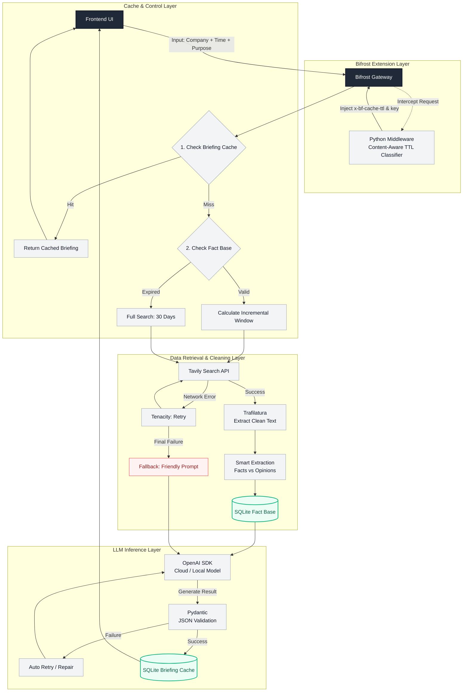

# Architecture — BriefCortex

## High-level flow

End-to-end data flow from the UI through the gateway, the retrieval and cleaning layer, to structured LLM output. This is the canonical diagram; `README.md` renders the same one.

### Three checkpoints and two stores

The diagram carries three decision points and two persistence layers:

| Checkpoint | Question | Keyed on |
|---|---|---|
| 1. Briefing cache | Has this exact brief already been produced? | company + time + purpose |
| 2. Fact base | Is the stored evidence still usable? | company + 30-day window |
| 3. Conflict validation | Do the retrieved facts contradict each other? | hard facts only |

| Store | Contents |
|---|---|
| `FactBase` | hard facts and opinions, reusable across purposes of the same company |
| `Briefing cache` | the finished report, so a repeat request returns without an LLM call |

Both are SQLite-backed in the diagram. A briefing hit returns straight to the UI. A fact-base hit only widens the retrieval window and re-runs inference, skipping retrieval entirely.

### Bifrost middleware at the edge

The request is intercepted before it reaches the cache layer. The Python middleware classifies the payload, then injects `x-bf-cache-ttl` and a `x-bf-cache-key` back into the gateway request — that pair is what makes the TTL content-aware rather than static. See `bifrost-time-aware-plugin/`.

## Implementation status

| Layer | State |
|---|---|
| Retrieval (Tavily, Tenacity, Trafilatura, structural extraction) | implemented in `app/services/ingestion.py` |
| Search planning and per-publisher scoping | implemented in `app/services/search_planner.py` and `ingestion.py` |
| Conflict validation | implemented in `app/services/conflict_detection.py` |
| Fact base and briefing persistence | implemented on Postgres (`app/repositories/`) |
| Bifrost middleware (TTL classifier) | implemented in `bifrost-time-aware-plugin/`; the gateway itself is not wired into the request path yet, so the headers reach the provider directly |
| Gateway cache checkpoints 1 and 2 | planned; config lives in `bifrost/config.json` |

## Modules

### Frontend (`frontend/`)

| Area | Responsibility |
|------|----------------|
| `app/` | Next.js App Router pages; `/` redirects to `/briefing` |
| `src/components/briefing/` | Form, report states, hover-expand briefings side panel |
| `src/hooks/briefing/` | Submit, poll, list, select, clone (client-only) |
| `src/api/` | Axios clients talking to FastAPI |
| `src/types/` | Shared TypeScript contracts |
| `src/lib/` | Env config and pure helpers |

### Backend (`backend/`)

| Area | Responsibility |
|------|----------------|
| `app/api/endpoints/` | Thin HTTP handlers |
| `app/services/briefing_service.py` | Async job accept + status orchestration |
| `app/repositories/` | Postgres data access only |
| `app/db/models.py` | SQLAlchemy ORM (`briefings` table, `report` JSONB) |
| `app/services/ingestion.py` | Tavily retrieval + FactBase assembly |
| `app/services/search_planner.py` | Model-driven search plan, constrained to a source registry |
| `bifrost-time-aware-plugin/` | Content-aware TTL classifier and cache-header middleware |
| `app/services/analysis.py` | LLM BriefingReport generation |
| `app/services/conflict_detection.py` | Deterministic fact conflict engine |
| `app/models/` | HTTP Pydantic schemas |
| `app/core/` | Settings + DB engine/session |

## Design decisions

1. **Async accept + poll** — briefing generation can take seconds; `202` + status polling keeps the UI responsive without websockets.
2. **App router separate from `src/`** — matches the Shabble layout so routes stay thin and logic lives in hooks/services.
3. **Postgres + repository** — each briefing is a row keyed by UUID; full report lives in one JSONB column because we only fetch by id today.
4. **Clone is client-only** — copies form fields into a new draft; no backend call until submit.
5. **Conflict detection stays off the LLM path** — conflicts are returned to callers independently and never serialized into the prompt.

## Anti-patterns

- Do not call FastAPI directly from React components — go through `src/api/`.
- Do not put business logic in FastAPI route handlers — keep it in services.
- Do not put SQL in services — go through repositories.
- Do not feed conflict-detection output into the LLM prompt.
- Do not promote unverified analyst opinions into `executive_summary.recommendation`.
