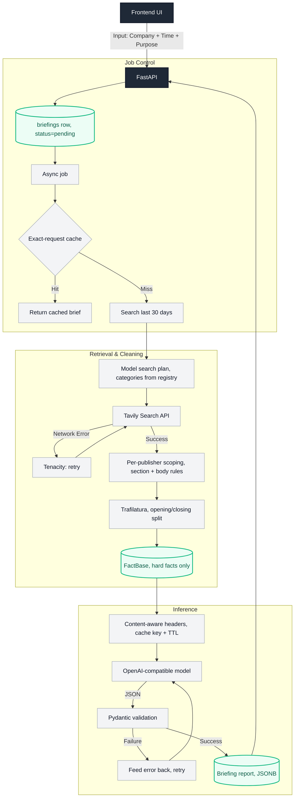

# Architecture — BriefCortex

## High-level flow

End-to-end data flow: the UI, the async job that owns the request, the retrieval and cleaning layer, and the structured LLM output. This is the canonical diagram; `README.md` renders the same one.

### Three checkpoints and two stores

The diagram carries three decision points and two persistence layers:

| Checkpoint | Question | Keyed on |
|---|---|---|
| 1. Briefing cache | Has this exact brief already been produced? | company + time + purpose |
| 2. Fact base | Is the stored evidence still usable? | company + 30-day window |
| 3. Conflict validation | Do the retrieved facts contradict each other? | hard facts only |

| Store | Contents |
|---|---|
| `FactBase` | hard facts and opinions, reusable across purposes of the same company |
| `Briefing cache` | the finished report, so a repeat request returns without an LLM call |

Both stores are planned; neither exists in code yet. A briefing hit would return straight to the UI, and a fact-base hit would only widen the retrieval window, skipping retrieval entirely. Today every request runs retrieval and inference.

### Content-aware cache headers

`bifrost_headers.py` classifies the evidence, then injects `x-bf-cache-ttl`, `x-bf-cache-key` and `x-bf-content-class` into the LLM request — that trio makes the TTL depend on the evidence rather than on a static default. See `bifrost-time-aware-plugin/README.md`.

## Implementation status

| Layer | State |
|---|---|
| Retrieval (Tavily, Tenacity, Trafilatura, structural extraction) | implemented in `app/services/ingestion.py`, `publisher_filter.py`, `fact_extraction.py` |
| Search planning and per-publisher scoping | implemented in `app/services/search_planner.py`, `source_rules.py`, `publisher_filter.py` |
| Conflict validation | implemented in `app/services/conflict_detection.py`; results are computed but not yet surfaced in the API response or the UI |
| Fact base and briefing persistence | implemented on Postgres (`app/repositories/`) |
| Content-aware cache headers | implemented in `app/services/bifrost_headers.py`; headers reach the provider directly, no cache store consumes them yet |
| Gateway cache checkpoints 1 and 2 | planned; config lives in `bifrost/config.json` |

## Modules

### Frontend (`frontend/`)

| Area | Responsibility |
|------|----------------|
| `app/` | Next.js App Router pages; `/` redirects to `/briefing` |
| `src/components/briefing/` | Form, report states, hover-expand briefings side panel |
| `src/hooks/briefing/` | Submit, poll, list, select, clone (client-only) |
| `src/api/` | Axios clients talking to FastAPI |
| `src/types/` | Shared TypeScript contracts |
| `src/lib/` | Env config and pure helpers |

### Backend (`backend/`)

| Area | Responsibility |
|------|----------------|
| `app/api/endpoints/` | Thin HTTP handlers |
| `app/services/briefing_service.py` | Async job accept, status orchestration, stale-job recovery |
| `app/repositories/` | Postgres data access only |
| `app/db/models.py` | SQLAlchemy ORM (`briefings` table, `report` JSONB) |
| `app/services/ingestion.py` | Tavily retrieval orchestration + FactBase assembly |
| `app/services/search_planner.py` | Model-driven search plan, constrained to a source registry |
| `app/services/source_rules.py` | Publisher registry and per-publisher extraction rules |
| `app/services/publisher_filter.py` | URL scoping, article-body location, text extraction |
| `app/services/fact_extraction.py` | Inverted-pyramid split, dedup, source ordering |
| `app/services/freshness.py` | Publication dates, date fallback, reporting-period checks |
| `app/services/bifrost_headers.py` | Content-aware cache key and TTL derived from the evidence |
| `app/services/analysis.py` | LLM BriefingReport generation |
| `app/services/conflict_detection.py` | Deterministic fact conflict engine |
| `app/services/keywords.py` | Shared word-boundary keyword matcher |
| `app/models/` | HTTP and pipeline Pydantic schemas |
| `app/core/` | Settings + DB engine/session |

## Design decisions

1. **Async accept + poll** — briefing generation can take seconds; `202` + status polling keeps the UI responsive without websockets. Jobs are held in a task set so the event loop cannot collect them mid-run, and a job stuck in `processing` is failed on the next startup.
2. **App router separate from `src/`** — routes stay thin and logic lives in hooks/services.
3. **Postgres + repository** — each briefing is a row keyed by UUID; full report lives in one JSONB column because we only fetch by id today.
4. **Clone is client-only** — copies form fields into a new draft; no backend call until submit.
5. **Conflict detection stays off the LLM path** — conflicts are returned to callers independently and never serialized into the prompt.
6. **One configuration channel** — every key is read through `app/core/config.py`, and the `.env` path is resolved against the module, so the service behaves the same from any working directory.

## Anti-patterns

- Do not call FastAPI directly from React components — go through `src/api/`.
- Do not put business logic in FastAPI route handlers — keep it in services.
- Do not put SQL in services — go through repositories.
- Do not feed conflict-detection output into the LLM prompt.
- Do not promote unverified analyst opinions into `executive_summary.recommendation`.
