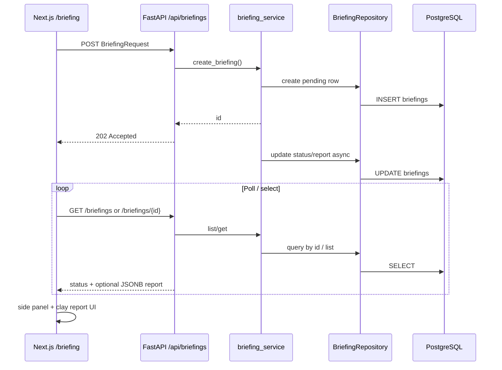

# Architecture — BriefCortex

## High-level flow

## Modules

### Frontend (`frontend/`)

| Area | Responsibility |
|------|----------------|
| `app/` | Next.js App Router pages; `/` redirects to `/briefing` |
| `src/components/briefing/` | Form, report states, hover-expand briefings side panel |
| `src/hooks/briefing/` | Submit, poll, list, select, clone (client-only) |
| `src/api/` | Axios clients talking to FastAPI |
| `src/types/` | Shared TypeScript contracts |
| `src/lib/` | Env config and pure helpers |

### Backend (`backend/`)

| Area | Responsibility |
|------|----------------|
| `app/api/endpoints/` | Thin HTTP handlers |
| `app/services/briefing_service.py` | Async job accept + status orchestration |
| `app/repositories/` | Postgres data access only |
| `app/db/models.py` | SQLAlchemy ORM (`briefings` table, `report` JSONB) |
| `app/services/ingestion.py` | Tavily retrieval + FactBase assembly |
| `app/services/search_planner.py` | Model-driven search plan, constrained to a source registry |
| `app/services/analysis.py` | LLM BriefingReport generation |
| `app/services/conflict_detection.py` | Deterministic fact conflict engine |
| `app/models/` | HTTP Pydantic schemas |
| `app/core/` | Settings + DB engine/session |

## Design decisions

1. **Async accept + poll** — briefing generation can take seconds; `202` + status polling keeps the UI responsive without websockets.
2. **App router separate from `src/`** — matches the Shabble layout so routes stay thin and logic lives in hooks/services.
3. **Postgres + repository** — each briefing is a row keyed by UUID; full report lives in one JSONB column because we only fetch by id today.
4. **Clone is client-only** — copies form fields into a new draft; no backend call until submit.
5. **Conflict detection stays off the LLM path** — conflicts are returned to callers independently and never serialized into the prompt.

## Anti-patterns

- Do not call FastAPI directly from React components — go through `src/api/`.
- Do not put business logic in FastAPI route handlers — keep it in services.
- Do not put SQL in services — go through repositories.
- Do not feed conflict-detection output into the LLM prompt.
- Do not promote unverified analyst opinions into `executive_summary.recommendation`.
